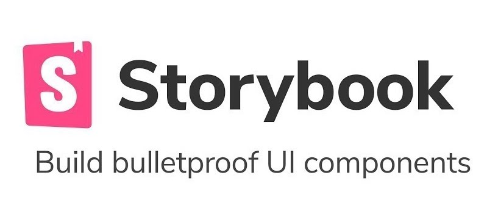
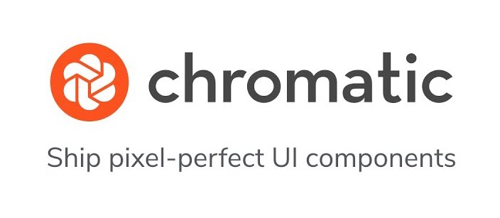
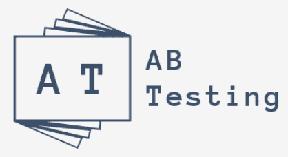

# Dotcom Rendering

This repository contains the rendering logic for theguardian.com website and a subset of content on the Guardian iOS and Android apps.

It primarily uses [TypeScript](https://www.typescriptlang.org/), [Node.js](https://nodejs.org/en), [Express](https://expressjs.com/), [React](https://reactjs.org/) and [Emotion](https://emotion.sh).

## Getting started

This guide will help you get the `dotcom-rendering` application running on your development machine.

### Clone the repository

Start in your `~/code` directory:

```
$ cd ~/code
```

Clone the repository from GitHub:

```
$ git clone git@github.com:guardian/dotcom-rendering.git
```

Change directory to the repository root:

```
$ cd dotcom-rendering
```

### Install mise

To install the correct versions of tools required to run dotcom-rendering, we _only_ support [mise](https://mise.jdx.dev/).

Follow the official documentation to install mise:<br>https://mise.jdx.dev/installing-mise.html#installing-mise

Add mise activation to your shell profile to run mise automatically when you change directories:<br>https://mise.jdx.dev/shell-setup.html#activate-mise-in-your-shell

The first time mise runs in a project it may, depending on the configuration, need to be trusted with:

`mise trust`

Optional but recommended, globally configure mise to auto update:

`mise settings set self_update.auto true`

Optional but recommended, globally configure mise to auto update given a minimum release age e.g.:

`mise settings set self_update.minimum_release_age 48h`

> [!IMPORTANT]
> If you have previously used fnm, nvm or asdf please disable any configuration that automatically sets tool versions on directory changes. This ensures any previous version management tool does not conflict with mise.

### Install tools

Ensure you're at the root directory of the project:

```
cd ~/code/dotcom-rendering
```

If mise has been configured to activate on directory changes the correct tool versions should now be installed and confirmation output to the terminal.

Otherwise you can manually install the required tooling with:

```
$ mise install
```

Confirm the active Node version matches the version in [.nvmrc](../.nvmrc)

```
$ node -v
```

Confirm the active pnpm version matches the `packageManager` property in [../package.json](../package.json)

```
$ pnpm -v
```

### Install dependencies

Change from the project root directory to the inner `dotcom-rendering` directory:

```
$ cd dotcom-rendering
```

Run

```
$ make install
```

If you get an Node version error then check your mise setup.

### Run

```sh
$ make dev
```

The development server will start on [http://localhost:3030](http://localhost:3030)

The development server home page lists examples of the various page and content types.

You can render a specific article by appending the production URL to the `Article` endpoint, for example:<br>http://localhost:3030/Article/https://www.theguardian.com/sport/2019/jul/28/tour-de-france-key-moments-egan-bernal-yellow-jersey

You can view the JSON data model of a page as sent by [Frontend](https://github.com/guardian/frontend) to DCR by appending `.json?dcr=true` to the production URL, for example:<br>https://www.theguardian.com/sport/2019/jul/28/tour-de-france-key-moments-egan-bernal-yellow-jersey.json?dcr=true

### Detailed setup

If you're trying to integrate with other applications, we also have a more [detailed setup guide](docs/contributing/detailed-setup-guide.md).

## VS Code

We recommend using [VS Code](https://code.visualstudio.com/).

### Settings

Required VS Code settings are in the file `.vscode/settings.json.required`.

Recommended VS Code settings are in the file `.vscode/settings.json.recommended`.

Copy the required settings and any recommended settings you wish to use over to `.vscode/settings.json` to activate them.

The `settings.json` file is git ignored to prevent it from overriding any individual developer's settings.

### TypeScript Version

Configure VS Code to use the workspace version of TypeScript and not its own bundled version using the following instructions:

https://code.visualstudio.com/docs/typescript/typescript-transpiling#_using-the-workspace-version-of-typescript

### Auto fix on save

We recommend you update your workspace settings to automatically fix formatting and linting errors on save, this avoids code style validation failures. These instructions assume you have installed the `esbenp.prettier-vscode` extension:

1. Open the Command Palette (`shift + cmd + P`) and select:

    ```
    Preferences: Open Workspace Settings (JSON)
    ```

2. If it doesn't already exist add the following:
    ```json
    "editor.codeActionsOnSave": {
    	"source.fixAll.eslint": true
    }
    ```

### Extensions

VS Code should prompt you to install our recommended extensions when you open the project.

You can also find these extensions by searching for `@recommended` in the extensions pane.

## Technologies

| Technology                                                                                                                 | Description                                                                                                                                                                                                                                                                                                                                       |
| -------------------------------------------------------------------------------------------------------------------------- | ------------------------------------------------------------------------------------------------------------------------------------------------------------------------------------------------------------------------------------------------------------------------------------------------------------------------------------------------- |
|                                                | DCR is written in [TypeScript](https://www.typescriptlang.org/)                                                                                                                                                                                                                                                                                   |
|                                                        | DCR is rendered on the server with Preact and uses Preact as the Client-side framework. We use preact-compat to ensure compatibility with React.                                                                                                                                                                                                  |
|                                            | [Emotion](https://emotion.sh) is a [css-in-js library](https://en.wikipedia.org/wiki/CSS-in-JS). DCR uses the [css](https://emotion.sh/docs/css-prop#string-styles) tagged template literal style to enable the use of vanilla CSS properties.                                                                                                    |
|                                                      | We use [Express](https://expressjs.com/) as a thin server to handle requests from Frontend.                                                                                                                                                                                                                                                       |
|                                                      | [Webpack](https://webpack.js.org/) is used for its dev server and as a bundler for our production code.                                                                                                                                                                                                                                           |
|                                                              | [SWC](https://swc.rs/) is used as a Webpack loader that allows for very fast compilation.                                                                                                                                                                                                                                                         |
|                                                  | We use [Storybook](https://storybook.js.org/) to generate [component variations](https://main--63e251470cfbe61776b0ef19.chromatic.com) that are then visual regression tested in [Chromatic](https://www.chromatic.com/). You'll notice `.stories.` files in the repository that define the component variations.                                 |
|                                                  | [Chromatic](https://www.chromatic.com/) is a visual regression testing tool that tests our Storybook components at PR time.                                                                                                                                                                                                                       |
|                                                            | [Jest](https://jestjs.io) is a unit testing tool. You will find Jest tests in the repo with `.test.` filenames.                                                                                                                                                                                                                                   |
|                                                | [Playwright](https://playwright.dev/) is an integration testing tool that runs tests in the browser. You will find the Playwright tests in the [playwright directory](./playwright).                                                                                                                                                              |
|                                                | The A/B Testing framework is developed in-house. There are [docs here](./docs/development/ab-testing-in-dcr.md).                                                                                                                                                                                                                                  |
|  | [Deno](https://deno.land/) is a JavaScript runtime that we've started incorporating into some of our Github Actions workflows. You will only need to install it if you are planning to run the workflow scripts locally. Some installation and troubleshooting instructions can be found in the [Deno scripts folder](../scripts/deno/README.md). |

## Concepts

There are some concepts to learn, that will make working with Dotcom Rendering clearer:

- Design and Display Types use the [Switch Pattern](docs/patterns/switch-on-display-design.md)
- [DecideLayout](docs/patterns/decide-layout.md)
- [Prop Drilling](https://kentcdodds.com/blog/prop-drilling/) (and [why we don't use React Context](docs/architecture/016-react-context-api.md))
- Dynamic imports
- [Enhancers](docs/patterns/enhancers.md)
- Data generated in Frontend

## Design system

[Source](https://theguardian.design) is the Guardian's design system. For detailed and up-to-date information on how to use it, see the [Source guide](https://github.com/guardian/csnx/blob/main/docs/source/README.md).

## Code quality

You can ensure your code passes code quality tests by running:

```sh
$ make validate
```

This runs our linting tool, the TypeScript compiler and our tests, before finally building the bundles.

You can also run these tasks individually:

```sh
$ make lint
$ make stylelint
$ make tsc
$ make test
```

If you get lint errors, you can attempt to automatically fix them with:

```sh
$ make fix
```

See [the makefile](./makefile) for the full list.

## Testing

[Testing tools and testing strategy](docs/testing.md)

## Debugging

DCR provides a visual debugging tool through a bookmarklet which you can find out more about in the [debug tool docs](./src/client/debug/README.md).

## Vulnerabilities

### Dependabot

To monitor vulnerabilities from GitHub, you can use [Dependabot alerts in the security tab](https://github.com/guardian/dotcom-rendering/security/dependabot).

### Manual audit

To check for vulnerabilities in development, you can run:

```sh
$ make audit
```
